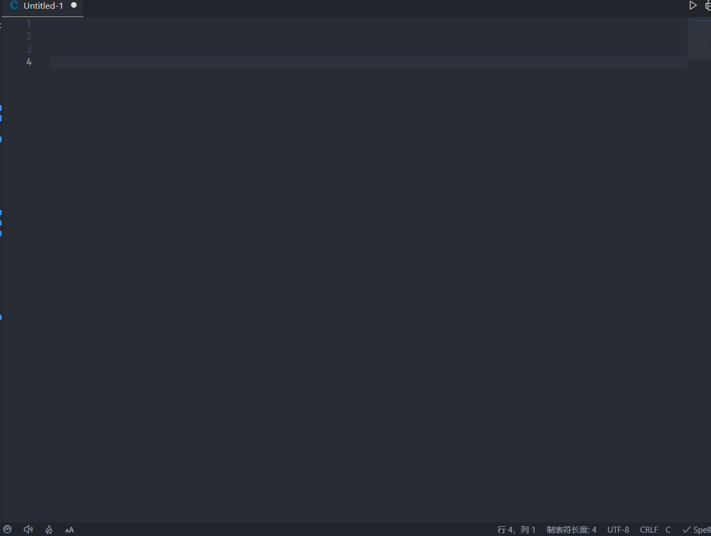
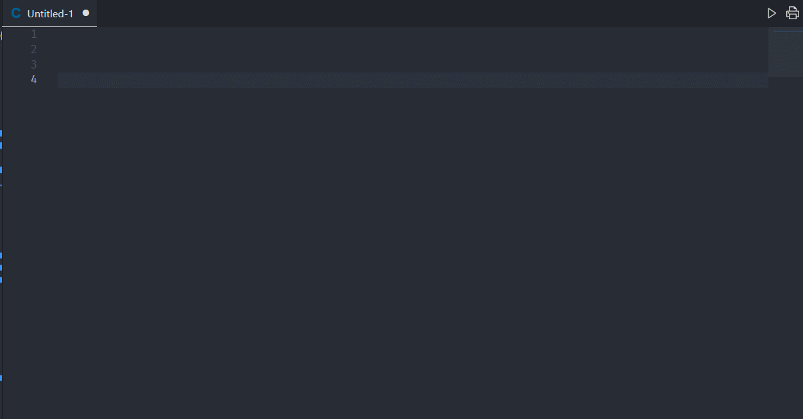

# vscode-ihyperdb-snippet

[](https://github.com/lilixxs/vscode-ihyperdb-snippet/actions/workflows/ci.yml)
[](https://marketplace.visualstudio.com/items?itemName=lilixxs.vscode-ihyperdb-snippet)

iHyperDB 计算点表达式的语法、内置函数、常用代码补全。
Snippets for iHyperDB calculation-point expressions: syntax, built-in functions, practical code.

- [插件地址 Marketplace](https://marketplace.visualstudio.com/items?itemName=lilixxs.vscode-ihyperdb-snippet)
- [代码仓库 Repository](https://github.com/lilixxs/vscode-ihyperdb-snippet)
- [iHyperDB 在线手册 Online manual](https://res.baowugroup.com/baosightproduct/wp-content/uploads/doc/ihdonline/welcomepage.htm)
- [计算点表达式章节 Calculation point](https://res.baowugroup.com/baosightproduct/wp-content/uploads/doc/ihdonline/tag_calculate.htm)


## 功能 Features

输入**任意一个关键词的一部分**，补全浮窗就会出现。
Type **part of any keyword** to open the suggestion list.

### 1. 逻辑语法 Syntax snippets

| 关键词 Keyword | 生成内容 Generates | 说明 Meaning |
| --- | --- | --- |
| `ihdifelse` | `IF() THEN() ELSE()` | 条件分支。`ELSE` 不能省略 — IF...THEN...ELSE, ELSE is mandatory |
| `ihdifelif` / `ihdifelseif` | `IF() THEN() ELSEIF() THEN() ELSE()` | 多分支 — multi-branch |
| `ihdCondition` / `?:!` | `(cond)?(true):(false)` | 三元运算符，可嵌套，嵌套时用括号 — ternary |
| `ihdNotEqual` / `<>` | `('tag1'<>'tag2')` | 不等于用 `<>`，不是 `!=` — not-equal operator |



### 2. 内置函数 Built-in functions

| 关键词 Keyword | 函数 Function | 说明 Meaning |
| --- | --- | --- |
| `ihdFilExtream` / `ihdFilExtreme` | `FilExtream('pt_tag', cal_tag, timeInterval, fValue)` | 极大值过滤 — filter extreme values by slope |
| `ihdTagYear` | `TagYear('pt_tag')` | 快照时间的年份 (2XXX) — year |
| `ihdTagMonth` | `TagMonth('pt_tag')` | 月份 (1-12) — month |
| `ihdTagDay` | `TagDay('pt_tag')` | 日 (1-31) — day |
| `ihdTagHour` | `TagHour('pt_tag')` | 小时 (0-23) — hour |
| `ihdTagMinute` | `TagMinute('pt_tag')` | 分钟 (0-59) — minute |
| `ihdTagSecond` | `TagSecond('pt_tag')` | 秒 (0-59) — second |
| `ihdTagWeekday` | `TagWeekday('pt_tag')` | 星期 (1-7) — weekday |
| `ihdTagYearday` | `TagYearday('pt_tag')` | 当年第几天 (1-366) — day of year |
| `ihdTagDaysec` | `TagDaysec('pt_tag')` | 当天第几秒 (0-86399) — second of day |
| `ihdTagUnixsec` | `TagUnixsec('pt_tag')` | 快照时间的 Unix 秒 — unix seconds |
| `ihdPrevVal` | `PrevVal('pt_tag')` | 上一条记录的值 — previous value |
| `ihdNoOutput` | `NoOutput()` | 不保存计算结果 — discard the result |
| `ihdBadVal` | `BadVal('pt_tag')` | 数据质量为 bad 时返回 1 — quality is bad |
| `ihdPreUnixsec` | `PreUnixsec('pt_tag')` | 上一条记录的 Unix 秒 — previous unix seconds |
| `ihdPreMs` | `PreMs('pt_tag')` | 上一条记录的毫秒 (0-999) — previous millisecond |
| `ihdNoneRecord` | `NoneRecord('pt_tag')` | 无记录返回 1，有记录返回 0 — no record |
| `ihdPreBadVal` | `PreBadVal('pt_tag')` | 上一条记录质量为 Good 返回 0 — previous quality |



### 3. 常用代码 Practical code snippets

| 关键词 Keyword | 生成内容 Generates | 说明 Meaning |
| --- | --- | --- |
| `ihdTriggerUP` | `if((PrevVal('t')==0)&&('t'==1))then(A)else(NoOutput())` | 上升沿 — positive transition |
| `ihdTriggerDown` | `if((PrevVal('t')==1)&&('t'==0))then(A)else(NoOutput())` | 下降沿 — negative transition |
| `ihdcompare3` / `between` | `if(('t'>=a)&&('t'<=b))then(A)else(B)` | 区间比较 — value between [a, b] |


## 表达式配置要点 Configuration rules

规则摘自官方手册「计算点」章节：

- 计算点的数据类型只能是 `int32` 或 `float64`。 — A calculation point is int32 or float64.
- 参与计算的点必须是普通点；`string`、`blob` 类型不能参与计算。
- 表达式的时间戳取所关联普通点中最新的时间戳，取值取最新的 snapshot。
- 计算失败（例如分母为 0）时，计算点不保存记录。
- 关联点是停机记录时仍然计算，计算点数据质量为 `BAD`。
- `IF` 语句不能缺少 `ELSE`；`IF` / `THEN` / `ELSE` 后的表达式都要加括号。
- 关系运算不支持连续比较。`'A'>'B'>3` 要写成 `('A'>'B')&&('B'>3)`。
- 正负号要用括号标明顺序，例如 `'int8'*(-1)`。
- 表达式以西文单引号开头时，整个表达式外层加括号，例如 `('tag1'+1)`，避免 Excel 配置时吞掉单引号。
- 计算表达式可以引用计算点自身。
- `FilExtream` 的计算周期要小于被过滤点的采集周期，`timeInterval` 要大于实际采集间隔。

## 运算符 Operators

优先级从高到低（数字越大越先算）：

| 优先级 | 运算符 | 含义 |
| --- | --- | --- |
| 12 | `!` | 逻辑非 |
| 11 | `~` | 按位取反 |
| 10 | `*` `/` | 乘、除 |
| 9 | `<<` `>>` | 左移、右移 |
| 8 | `>` `>=` `<` `<=` | 大小比较 |
| 7 | `==` `<>` | 等于、不等于 |
| 6 | `&` | 按位与 |
| 5 | `^` | 按位异或 |
| 4 | `\|` | 按位或 |
| 3 | `&&` | 逻辑与 |
| 2 | `\|\|` | 逻辑或 |
| 1 | `?:` | 条件运算符 |

关系运算的结果是布尔值：满足为 `1`，不满足为 `0`。
位运算只支持整型操作数，非整型会强制转换为 `int32`。

## 使用要求 Requirements

无。插件不含运行时代码，只提供片段。 — No runtime dependency.

## 插件设置 Extension Settings

**只在 C 语言模式下生效。** 片段通过 `contributes.snippets` 挂到语言 ID `c`。
**Runs only in C language mode**, because the snippet contribution targets the `c` language id.


## 已知问题 Known Issues

- 部分片段关键词与 C 语言自身的补全词重叠，这是 iHD 语法决定的。
- `TagWeekday` 的 1-7 与星期的对应关系以现场服务端定义为准，手册未给出映射。

## 版本发布 Release Notes

### 0.1.1

- 发布流程修复：0.1.0 的上传未被 Marketplace 收录，改用 0.1.1 重新发布。
- 流水线新增「校验 Marketplace 已上线」步骤，版本未生效时报错。

### 0.1.0

- 修正 `contributes.snippets.language`：由 `'c'` 改为 `c`。此前语言 ID 带引号，片段不会挂载。
- 按官方手册补齐 3 个内置函数：`TagWeekday`、`BadVal`、`PreUnixsec`。
- 新增 `<>` 不等于运算符片段。
- 修正 `TagMinute` 取值区间：0-69 改为 0-59。
- 修正 `TagYearday`、`TagDaysec`、`TagUnixsec`、`PreBadVal` 描述里的错误示例行。
- 补全 `FilExtream` 的斜率规则、最大间隔规则、坏质量点规则。
- 新增校验脚本、CI 与标签发布流水线。

### 0.0.4

已发布到 Marketplace，仓库未记录对应提交。

### 0.0.2 / 0.0.3

更新 README 与包信息。Update README and package metadata.

### 0.0.1

最初版本。Initial release.

## 开发 Development

```bash
npm ci                # 安装开发依赖
npm run validate      # 校验片段、清单、README 是否自洽
npm run package       # 生成 vsix
npm run test:smoke    # 在真实 VS Code 里验证补全是否出现（需本机装 VS Code）
```

发布：推送 `v<version>` 标签，由 `.github/workflows/release.yml` 打包并发布。
Marketplace 使用 Trusted Publishing（OIDC），不需要配置 `VSCE_PAT`。
Open VSX 需要可选的 `OVSX_PAT`，未配置时跳过。
标签必须与 `package.json` 版本一致，否则流水线失败。

## 更多信息 For more information

- [iHyperDB 产品介绍](https://product.baosight.com/products/4200)
- [iHyperDB 在线手册](https://res.baowugroup.com/baosightproduct/wp-content/uploads/doc/ihdonline/welcomepage.htm)
